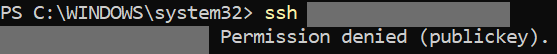
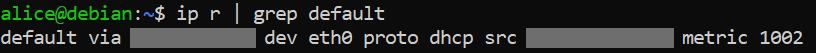
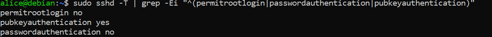

# 01 - Serveur Linux sécurisé

## Objectif
Se connecter à la VM **uniquement par clé SSH**, interdire `root`, n'avoir **qu'une seule route par défaut** et activer les **mises à jour de sécurité automatiques**.

## Machine
VM locale Debian 13 (Hyper-V), deux cartes réseau :
- `eth0` : DHCP, accès Internet (switch par défaut Hyper-V)
- `eth1` : IP statique `<IP_PRIVEE>/24`, réseau privé, **sans passerelle**

## 1. Créer l'utilisateur d'administration
En `root` sur la VM :
```bash
apt update && apt install -y sudo
adduser <UTILISATEUR>
usermod -aG sudo <UTILISATEUR>
```

## 2. Configurer le réseau (`/etc/network/interfaces`)
```bash
sudo nano /etc/network/interfaces
```
```
auto lo
iface lo inet loopback

auto eth0
iface eth0 inet dhcp

auto eth1
iface eth1 inet static
    address <IP_PRIVEE>
    netmask 255.255.255.0
```
> Ne mettez **pas** de ligne `gateway` sur `eth1` : cela crée une deuxième route par défaut (erreur classique).

```bash
sudo systemctl restart networking
ip -br a
ip r | grep default
```

## 3. Déposer sa clé SSH depuis Windows
Dans PowerShell sur le poste client :
```powershell
ssh-keygen -t ed25519
type $env:USERPROFILE\.ssh\id_ed25519.pub | ssh <UTILISATEUR>@<IP_VM> "mkdir -p ~/.ssh && chmod 700 ~/.ssh && cat >> ~/.ssh/authorized_keys && chmod 600 ~/.ssh/authorized_keys"
ssh <UTILISATEUR>@<IP_VM> "whoami"
```

## 4. Durcir SSH
```bash
sudo tee /etc/ssh/sshd_config.d/10-durcissement.conf > /dev/null <<'CONF'
PermitRootLogin no
PasswordAuthentication no
CONF
sudo sshd -t && sudo systemctl reload ssh
```
> Les fichiers de `sshd_config.d` sont lus **par ordre alphabétique** et **la première valeur gagne**. Supprimez tout fichier qui réactive le mot de passe (ex. `00-temp-password.conf`).

```bash
ls -l /etc/ssh/sshd_config.d/
```

## 5. Mises à jour automatiques
```bash
sudo apt install -y unattended-upgrades
sudo dpkg-reconfigure -plow unattended-upgrades
```

## Vérification
Sur la VM :
```bash
sudo sshd -T | grep -Ei "^(permitrootlogin|passwordauthentication|pubkeyauthentication)"
ip r | grep default
systemctl is-enabled unattended-upgrades ; systemctl is-active unattended-upgrades
sort ~/.ssh/authorized_keys | uniq -c
```
Attendu : `permitrootlogin no`, `passwordauthentication no`, une seule ligne `default`, `enabled` et `active`.

Depuis le poste client :
```powershell
ssh root@<IP_VM>
ssh -o PubkeyAuthentication=no <UTILISATEUR>@<IP_VM>
ssh <UTILISATEUR>@<IP_VM> "whoami"
```
Attendu : les deux premières renvoient `Permission denied (publickey)`, la troisième renvoie le nom de l'utilisateur.

## Pièges
- Contrôler la **configuration effective** avec `sshd -T`, pas seulement le fichier.
- Une faute de frappe (`PasswordAuthentification`) est ignorée silencieusement : `sshd -t` ne la signale pas toujours.
- L'IP DHCP de `eth0` peut changer après un redémarrage d'Hyper-V.

## Captures

**Connexion root refusée depuis le poste client**



**Une seule route par défaut**



**Configuration SSH effective**


