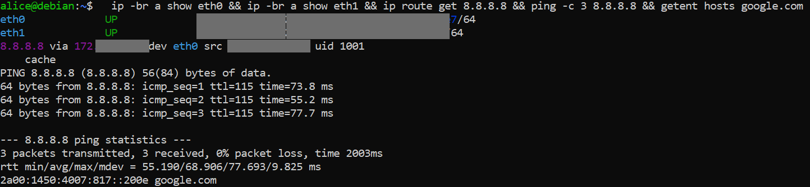

# 02 - Le réseau, couche par couche

## Objectif
Lire la configuration réseau d'une machine et savoir **diagnostiquer une panne** en testant chaque couche de bas en haut.

## Machine
VM locale Debian 13.

## 1. Relever la configuration
```bash
ip -br a
ip r
cat /etc/resolv.conf
```
À noter : IP et masque de chaque carte, passerelle (`default via`), serveur DNS (`nameserver`).

| Terme | Signification |
|---|---|
| `default via X` | tout ce qui n'est pas un réseau connu part vers la passerelle X |
| `scope link` | réseau directement joignable, sans passerelle |
| `metric` | priorité de la route (la plus petite gagne) |
| `nameserver` | serveur qui traduit les noms en adresses IP |

## 2. Tester couche par couche
```bash
ip -br a show eth0 && ip -br a show eth1
ip route get 8.8.8.8
ping -c 3 $(ip r | awk '/^default/ {print $3; exit}')
ping -c 3 8.8.8.8
getent hosts google.com
dig +short google.com
```

| Couche | Commande | Si ça échoue |
|---|---|---|
| Interface | `ip -br a` | carte `DOWN` ou sans IP : DHCP, câble virtuel, switch |
| Route | `ip route get 8.8.8.8` | pas de route par défaut |
| Passerelle | `ping <passerelle>` | réseau local ou switch Hyper-V |
| Internet | `ping 8.8.8.8` | problème au-delà de la passerelle |
| Nom | `getent hosts google.com` | problème **DNS uniquement** |

## Vérification
Les cinq tests passent. Méthode : la **première couche en échec** désigne la panne.

## Pièges
- `ping 8.8.8.8` OK mais `getent` KO : c'est le DNS, pas le réseau.
- Certains réseaux bloquent le DNS direct vers `1.1.1.1` : seul le résolveur local répond (`dig @1.1.1.1` en échec est alors normal).

## Captures

**Tests réseau couche par couche**


