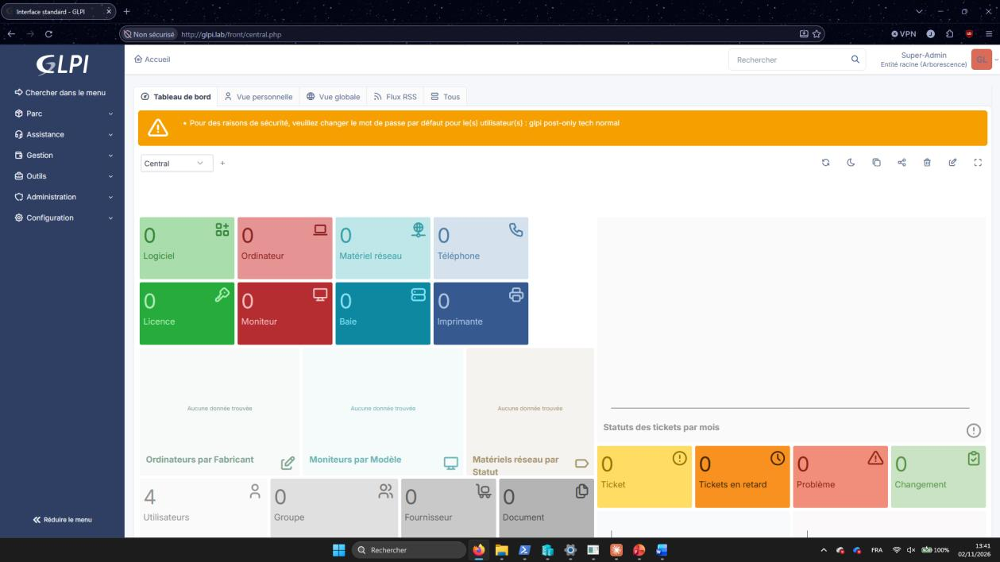
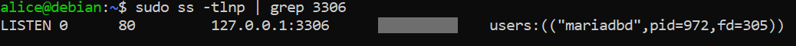

# 03 - Héberger à la main : GLPI sur LAMP

## Objectif
Installer GLPI sur une pile **Apache + PHP + MariaDB**, accessible sur `http://glpi.lab`, puis le **sécuriser**.

## Machine
VM locale Debian 13 (pas de Docker sur cette machine).

## 1. Installer la pile LAMP
```bash
sudo apt update
sudo apt install -y apache2 mariadb-server php libapache2-mod-php php-mysql php-curl php-gd php-intl php-ldap php-mbstring php-xml php-zip php-bz2 php-bcmath unzip wget
```

## 2. Créer la base de données
```bash
sudo mariadb -e "CREATE DATABASE glpi CHARACTER SET utf8mb4 COLLATE utf8mb4_unicode_ci;"
sudo mariadb -e "CREATE USER 'glpi'@'localhost' IDENTIFIED BY '<MOT_DE_PASSE_BDD>';"
sudo mariadb -e "GRANT ALL PRIVILEGES ON glpi.* TO 'glpi'@'localhost'; FLUSH PRIVILEGES;"
```

## 3. Télécharger GLPI
Récupérer l'archive de la dernière version sur https://github.com/glpi-project/glpi/releases puis :
```bash
cd /tmp
wget https://github.com/glpi-project/glpi/releases/download/<VERSION>/glpi-<VERSION>.tgz
sudo tar -xzf glpi-<VERSION>.tgz -C /var/www/
sudo chown -R www-data:www-data /var/www/glpi
```

## 4. Créer le VirtualHost
```bash
sudo tee /etc/apache2/sites-available/glpi.conf > /dev/null <<'CONF'
<VirtualHost *:80>
    ServerName glpi.lab
    DocumentRoot /var/www/glpi/public
    <Directory /var/www/glpi/public>
        Require all granted
        RewriteEngine On
        RewriteCond %{REQUEST_FILENAME} !-f
        RewriteRule ^(.*)$ index.php [QSA,L]
    </Directory>
</VirtualHost>
CONF
sudo a2enmod rewrite
sudo a2ensite glpi
sudo a2dissite 000-default
sudo systemctl reload apache2
```

## 5. Déclarer `glpi.lab` sur le poste client
Dans un Bloc-notes **lancé en administrateur**, ouvrir `C:\Windows\System32\drivers\etc\hosts` et ajouter :
```
<IP_VM>    glpi.lab
```
Puis ouvrir `http://glpi.lab` et suivre l'assistant (base `glpi`, utilisateur `glpi`).

## 6. Durcir
```bash
sudo sed -i 's/^;\?session.cookie_httponly.*/session.cookie_httponly = On/' /etc/php/*/apache2/php.ini
sudo sed -i 's/^bind-address\s*=.*/bind-address = 127.0.0.1/' /etc/mysql/mariadb.conf.d/50-server.cnf
sudo systemctl restart mariadb apache2
sudo rm -f /var/www/glpi/install/install.php
```
Dans GLPI (**Administration > Utilisateurs**) :
1. Créer son propre compte avec le profil **Super-Admin**.
2. Se reconnecter avec ce compte.
3. Mettre à la corbeille puis **purger** `glpi`, `tech`, `normal`, `post-only` (ne pas toucher à `glpi-system`).

## Vérification
```bash
grep -n "^session.cookie_httponly" /etc/php/*/apache2/php.ini
sudo ss -tlnp | grep 3306
curl -s -o /dev/null -w "%{http_code}\n" -H "Host: glpi.lab" http://localhost
sudo mariadb -e "SELECT name,is_active,is_deleted,password_last_update FROM glpi.glpi_users;"
```
Attendu : `session.cookie_httponly = On`, `127.0.0.1:3306`, `200`, plus que `glpi-system` et votre compte.

## Pièges
- Le DocumentRoot doit pointer sur `/public`, sinon GLPI affiche un avertissement de sécurité.
- Si l'IP de la VM change, mettre à jour le fichier `hosts` du PC.

## Captures

**GLPI installé (bandeau des comptes par défaut avant nettoyage)**



**MariaDB limité à 127.0.0.1**


