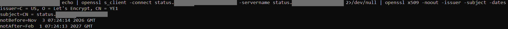
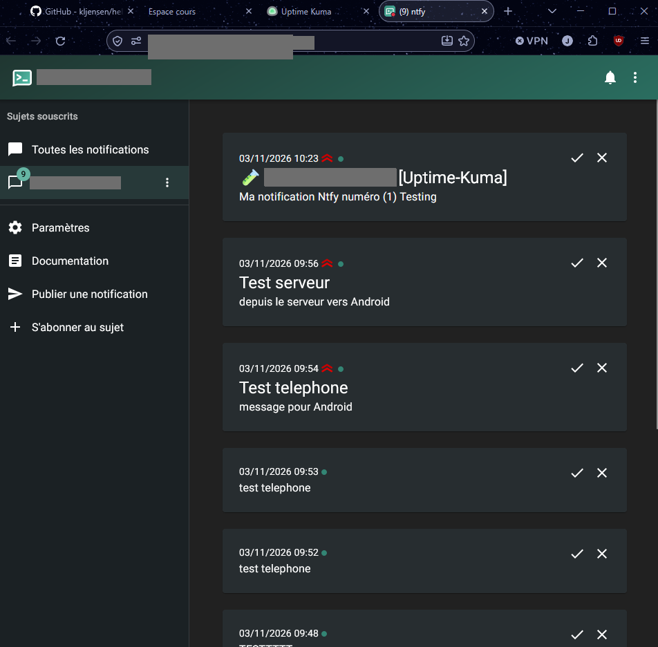

# 06 - HTTPS et noms de domaine avec Caddy

## Objectif
Publier Kuma et ntfy sous des **noms lisibles**, en **HTTPS** avec un certificat **Let's Encrypt** obtenu automatiquement, et rediriger HTTP vers HTTPS.

## Machine
Serveur cloud Ubuntu 24.04.

## 1. Créer les enregistrements DNS
Dans l'interface de gestion du domaine, créer deux enregistrements **A** vers `<IP_SERVEUR>` :
```
status.<DOMAINE>   A   <IP_SERVEUR>
notif.<DOMAINE>    A   <IP_SERVEUR>
```
Vérifier la propagation :
```bash
dig +short status.<DOMAINE>
dig +short notif.<DOMAINE>
```

## 2. Écrire le Caddyfile
```bash
cd /srv/plateforme
sudo tee Caddyfile > /dev/null <<'CADDY'
status.<DOMAINE> {
    reverse_proxy kuma:3001
}

notif.<DOMAINE> {
    reverse_proxy ntfy:80
}
CADDY
sudo docker compose up -d
sudo docker compose logs caddy --tail 40 | grep -Ei "obtained|error|challenge"
```
Attendu : `certificate obtained successfully` pour chaque nom.

## 3. Configurer Kuma et ntfy
- Ouvrir `https://status.<DOMAINE>` et créer le compte administrateur **immédiatement** (la page de création est publique tant qu'aucun compte n'existe).
- Installer l'application **ntfy** sur le téléphone, ajouter le serveur `https://notif.<DOMAINE>` et s'abonner au sujet `<SUJET_NTFY>`.
- Dans Kuma : **Paramètres > Notifications > ntfy**, URL `https://notif.<DOMAINE>`, sujet `<SUJET_NTFY>`, puis créer une sonde HTTP.

Test d'envoi depuis le serveur :
```bash
curl -d "Test depuis le serveur" https://notif.<DOMAINE>/<SUJET_NTFY>
```

## Vérification
```bash
echo | openssl s_client -connect status.<DOMAINE>:443 -servername status.<DOMAINE> 2>/dev/null | openssl x509 -noout -issuer -subject -dates
curl -sI http://status.<DOMAINE> | head -3
curl -sI https://notif.<DOMAINE> | head -2
```
Attendu : émetteur `Let's Encrypt`, redirection `308 Permanent Redirect`, réponse `200` pour ntfy.

## Pièges
- Remplacer les domaines d'exemple du sujet par les vôtres : sinon `Could not resolve host`.
- Si Caddy a été créé pendant une panne réseau ou pare-feu, le recréer : `sudo docker compose up -d --force-recreate caddy`.
- Les ports 80 **et** 443 doivent être ouverts : Let's Encrypt valide le domaine via le port 80 (défi HTTP-01).

## Captures

**Certificat Let's Encrypt obtenu par Caddy**



**Notifications ntfy reçues**


