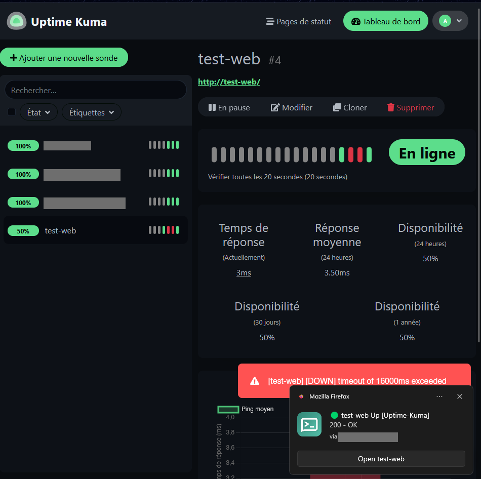
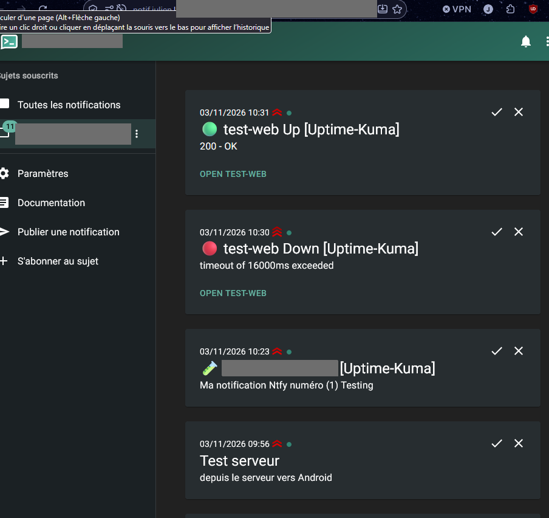
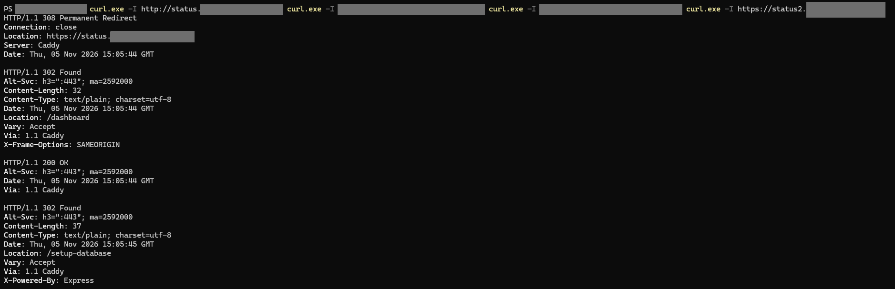

# 09 - Recette finale depuis le poste client

## Objectif
Vérifier, **comme un utilisateur**, que la plateforme fonctionne de bout en bout : HTTPS, redirection, services et chaîne d'alerte.

## Machine
Poste client Windows (PowerShell) + téléphone avec l'application ntfy.

## 1. Tests HTTP / HTTPS
```powershell
curl.exe -I http://status.<DOMAINE>
curl.exe -I https://status.<DOMAINE>
curl.exe -I https://notif.<DOMAINE>
curl.exe -I https://status2.<DOMAINE>
```
| Test | Attendu |
|---|---|
| `http://status...` | `308 Permanent Redirect` vers `https://` |
| `https://status...` | `302 Found` vers `/dashboard` (Kuma) |
| `https://notif...` | `200 OK`, `Via: 1.1 Caddy` |
| `https://status2...` | `302 Found` (VM reconstruite par Ansible) |

## 2. Surface exposée
```powershell
foreach ($p in 22,80,443,3001,3306,8080,8081) { Test-NetConnection <IP_SERVEUR> -Port $p -WarningAction SilentlyContinue | Select-Object RemotePort, TcpTestSucceeded }
```

## 3. Chaîne d'alerte
1. Dans Kuma, créer une sonde HTTP `test-web` vers une URL qui ne répond pas (ou mettre en pause la cible).
2. Attendre la notification **DOWN** sur le téléphone.
3. Remettre une URL valide et attendre la notification **UP**.

## Vérification finale
- [ ] Cadenas valide sur `status` et `notif`
- [ ] HTTP redirige vers HTTPS
- [ ] Seuls 22, 80 et 443 répondent depuis l'extérieur
- [ ] Notifications DOWN puis UP reçues sur le téléphone
- [ ] Dernière sauvegarde `auto` présente et `restic check` sans erreur
- [ ] `ansible-playbook site.yml` renvoie `changed=0`

## Captures

**Sonde Kuma passée DOWN volontairement**



**Alertes DOWN puis UP reçues dans ntfy**



**Tests de recette depuis le poste client**


