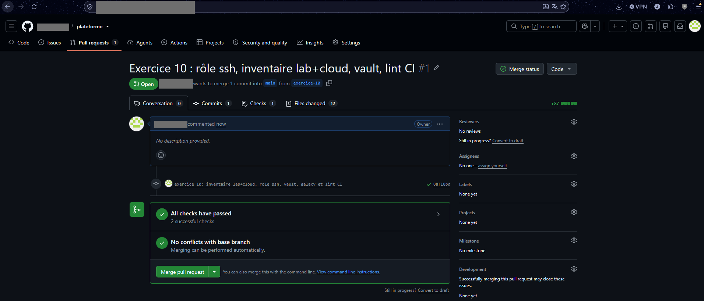
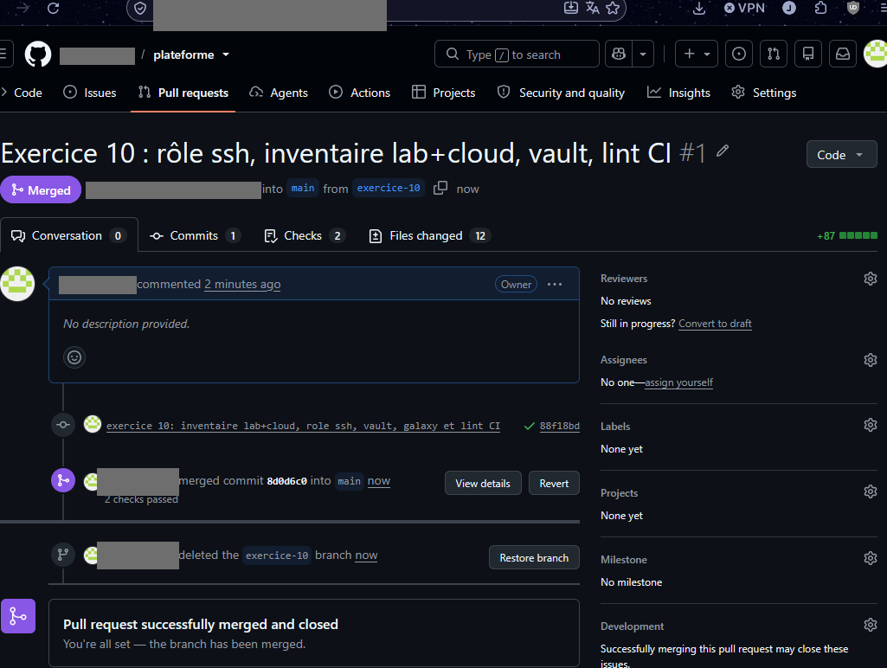
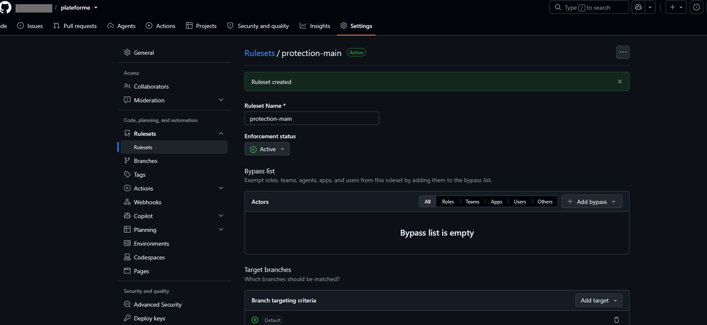
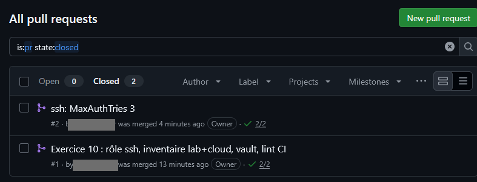

# 10 - Git, GitHub et Ansible : piloter plusieurs serveurs depuis un dépôt

## Objectif
Piloter **plusieurs machines** depuis un seul nœud de contrôle, ranger la configuration en **rôles Ansible**, protéger les secrets avec **Vault**, et faire passer chaque changement par **Git** : branche, pull request, contrôle automatique (GitHub Actions), fusion, application, `changed=0`.

## Machines
| Nom dans cette doc | Rôle |
|---|---|
| `srv-lab` | VM locale Debian (`<IP_PRIVEE>`) : **nœud de contrôle** et machine du groupe `lab` |
| `vps` | Serveur cloud (`<DOMAINE>`) : machine du groupe `cloud` |
| GitHub | Dépôt `<COMPTE_GITHUB>/plateforme` (celui de l'étape 8) |

> Le nœud de contrôle peut aussi être WSL sur votre PC. Ici, tout se fait dans la VM de lab : rien n'est installé sur le poste Windows.

## 1. Préparer le nœud de contrôle
Faire d'abord un snapshot de la VM (PowerShell administrateur) :
```powershell
Checkpoint-VM -Name <NOM_VM> -SnapshotName "avant-git-ansible"
```
Sur `srv-lab` : Ansible, Git et une clé SSH dédiée (la clé personnelle du PC ne bouge pas) :
```bash
sudo apt update && sudo apt install -y ansible git && { [ -f ~/.ssh/id_ed25519 ] || ssh-keygen -t ed25519 -C "<UTILISATEUR>@srv-lab" -f ~/.ssh/id_ed25519 -N ""; } && grep -qf ~/.ssh/id_ed25519.pub ~/.ssh/authorized_keys || cat ~/.ssh/id_ed25519.pub >> ~/.ssh/authorized_keys; ansible --version | head -1; cat ~/.ssh/id_ed25519.pub
```
Autoriser cette clé sur le VPS (depuis le PC, qui a déjà accès aux deux machines) :
```powershell
ssh <UTILISATEUR>@<IP_PRIVEE> "cat ~/.ssh/id_ed25519.pub" | ssh <UTILISATEUR_VPS>@<DOMAINE> "cat >> ~/.ssh/authorized_keys"
```
Déclarer la clé sur GitHub : **Settings › SSH and GPG keys › New SSH key**, titre `srv-lab`, coller la ligne `ssh-ed25519 …`.

Vérifier les 3 accès depuis `srv-lab` :
```bash
ssh -o StrictHostKeyChecking=accept-new <UTILISATEUR>@<IP_PRIVEE> hostname && ssh -o StrictHostKeyChecking=accept-new <UTILISATEUR_VPS>@<DOMAINE> hostname && ssh -o StrictHostKeyChecking=accept-new -T git@github.com
```
Attendu : le nom de la VM, le nom du VPS, puis `Hi <COMPTE_GITHUB>! You've successfully authenticated…`.

## 2. Inventaire multi-machines
```bash
cd ~ && git clone git@github.com:<COMPTE_GITHUB>/plateforme.git && cd ~/plateforme/ansible && cat > lab-cloud.ini <<'EOF'
[lab]
srv-lab ansible_host=<IP_PRIVEE> ansible_user=<UTILISATEUR>

[cloud]
vps ansible_host=<DOMAINE> ansible_user=<UTILISATEUR_VPS>

[plateforme:children]
lab
cloud
EOF
ansible all -i lab-cloud.ini -m ping && ansible-inventory -i lab-cloud.ini --graph && ansible vps -i lab-cloud.ini -a 'df -h /'
```
> Fichier séparé de `inventory.ini` : celui-ci sert encore au playbook lancé en local sur le serveur (étape 8).

Attendu : `pong` pour les deux machines, l'arbre `@plateforme` › `@lab` / `@cloud`.

## 3. Idempotence : `shell` contre `lineinfile`
Démonstration sur une **copie** de `sshd_config` dans `/tmp` :
```bash
cd ~/plateforme/ansible && cat > demo-idempotence.yml <<'EOF'
---
- name: Démo idempotence - shell contre lineinfile (copie dans /tmp)
  hosts: srv-lab
  tasks:
    - name: Préparer une copie de test de sshd_config
      ansible.builtin.copy:
        src: /etc/ssh/sshd_config
        dest: /tmp/demo_sshd_config
        remote_src: true
        force: false

    - name: A éviter - shell ajoute la ligne à chaque passage
      ansible.builtin.shell:
        cmd: echo 'PermitRootLogin no' >> /tmp/demo_sshd_config

    - name: A préférer - lineinfile écrit seulement si la ligne diffère
      ansible.builtin.lineinfile:
        path: /tmp/demo_sshd_config
        regexp: '^#?PermitRootLogin'
        line: PermitRootLogin no
EOF
ansible-playbook -i lab-cloud.ini demo-idempotence.yml && ansible-playbook -i lab-cloud.ini demo-idempotence.yml && grep -n "PermitRootLogin" /tmp/demo_sshd_config
```
Attendu : la tâche `shell` est `changed` à chaque passage (une ligne de plus à chaque fois), `lineinfile` reste `ok`.

## 4. Un rôle `ssh`
```bash
cd ~/plateforme/ansible && mkdir -p roles/ssh/{defaults,tasks,templates,handlers} && cat > roles/ssh/defaults/main.yml <<'EOF'
---
ssh_permit_root_login: "no"
ssh_password_authentication: "no"
ssh_pubkey_authentication: "yes"
EOF
cat > roles/ssh/templates/durcissement.conf.j2 <<'EOF'
# Géré par Ansible (rôle ssh) - ne pas modifier à la main
PermitRootLogin {{ ssh_permit_root_login }}
PasswordAuthentication {{ ssh_password_authentication }}
PubkeyAuthentication {{ ssh_pubkey_authentication }}
EOF
cat > roles/ssh/tasks/main.yml <<'EOF'
---
- name: Déposer la config SSH
  ansible.builtin.template:
    src: durcissement.conf.j2
    dest: /etc/ssh/sshd_config.d/10-cours.conf
    owner: root
    group: root
    mode: "0644"
    validate: /usr/sbin/sshd -t -f %s
  notify: Redémarrer ssh
EOF
cat > roles/ssh/handlers/main.yml <<'EOF'
---
- name: Redémarrer ssh
  ansible.builtin.service:
    name: ssh
    state: reloaded
EOF
cat > ssh.yml <<'EOF'
---
- name: Durcissement SSH sur toute la plateforme
  hosts: plateforme
  become: true
  roles:
    - ssh
EOF
```
Prévisualiser, appliquer, rejouer :
```bash
cd ~/plateforme/ansible && ansible-playbook -i lab-cloud.ini ssh.yml -K --check --diff && ansible-playbook -i lab-cloud.ini ssh.yml -K && ansible-playbook -i lab-cloud.ini ssh.yml -K
```
Attendu : `changed=2` (fichier + handler) puis **`changed=0`** au 2e passage. Vérifier sur les deux machines :
```bash
cd ~/plateforme/ansible && ansible plateforme -i lab-cloud.ini -b -K -m shell -a 'ls /etc/ssh/sshd_config.d/ && sshd -T | grep -Ei "^(permitrootlogin|passwordauthentication|pubkeyauthentication|maxauthtries)"'
```
> Garder une session SSH ouverte sur chaque machine pendant l'application. `validate` refuse un fichier invalide avant qu'il ne remplace la configuration.

## 5. Vault, Galaxy, ansible-lint
**Vault** : chiffrer le mot de passe sudo de `srv-lab` pour ne plus taper `-K`.
```bash
cd ~/plateforme/ansible && mkdir -p group_vars/lab && EDITOR=nano ansible-vault create group_vars/lab/vault.yml
```
Contenu à saisir dans l'éditeur : `vault_become_password: "<MOT_DE_PASSE_SUDO>"`. Puis :
```bash
cd ~/plateforme/ansible && cat > group_vars/lab/vars.yml <<'EOF'
---
ansible_become_password: "{{ vault_become_password }}"
EOF
head -1 group_vars/lab/vault.yml && ansible-playbook -i lab-cloud.ini ssh.yml --ask-vault-pass
```
Attendu : `$ANSIBLE_VAULT;1.1;AES256`. Le fichier chiffré peut être versionné ; **le mot de passe Vault, jamais**.

**Galaxy** :
```bash
cd ~/plateforme/ansible && cat > requirements.yml <<'EOF'
---
collections:
  - name: community.docker
  - name: ansible.posix
EOF
ansible-galaxy collection install -r requirements.yml
```

**ansible-lint** :
```bash
sudo apt install -y ansible-lint && cd ~/plateforme/ansible && ansible-lint ssh.yml roles/ssh ; ansible-lint demo-idempotence.yml
```
Attendu : le rôle passe au profil `production` ; la démo est signalée (`no-changed-when` sur la tâche `shell`).

## 6. Branche, pull request, GitHub Actions
Workflow de contrôle automatique :
```bash
cd ~/plateforme && git config --global user.name "<NOM_PRENOM>" && git config --global user.email "<COMPTE_GITHUB>@users.noreply.github.com" && git switch -c exercice-10 && mkdir -p .github/workflows && cat > .github/workflows/lint.yml <<'EOF'
name: lint
on: [push, pull_request]
jobs:
  ansible:
    runs-on: ubuntu-latest
    steps:
      - uses: actions/checkout@v4
      - run: pipx install ansible-lint
      - run: ansible-lint ssh.yml roles/ssh
        working-directory: ansible
EOF
printf '.vault_pass*\n*.retry\n' >> .gitignore && head -1 ansible/group_vars/lab/vault.yml && git add .gitignore .github ansible && git commit -m "inventaire lab+cloud, role ssh, vault, galaxy et lint CI" && git push -u origin exercice-10
```
Sur GitHub : **Compare & pull request › Create pull request**, attendre le contrôle `lint / ansible` vert, puis **Merge pull request › Delete branch**. Récupérer la fusion :
```bash
cd ~/plateforme && git switch main && git fetch origin && git log --oneline main..origin/main && git pull --rebase
```
> Une adresse `users.noreply.github.com` cache votre mail dans les commits en ligne de commande. Pour les fusions faites sur le site, activer aussi **Settings › Emails › Keep my email addresses private**.

## 7. Protéger `main`
**Settings › Rules › Rulesets › New branch ruleset** :
- Enforcement : `Active`, cible : **Include default branch**
- **Restrict deletions**, **Block force pushes**
- **Require a pull request before merging** (approbations : 0 si vous êtes seul)
- **Require status checks to pass** › check `ansible`

Prouver qu'un push direct est refusé, puis annuler le test :
```bash
cd ~/plateforme && echo "test" > test-push-direct.txt && git add test-push-direct.txt && git commit -m "test: push direct sur main" && git push origin main ; git reset --hard origin/main && git status -sb
```
Attendu : `GH013: Repository rule violations` / `Changes must be made through a pull request`.

## 8. La boucle complète
```bash
cd ~/plateforme && git switch -c fix/ssh && printf 'ssh_max_auth_tries: 3\n' >> ansible/roles/ssh/defaults/main.yml && printf 'MaxAuthTries {{ ssh_max_auth_tries }}\n' >> ansible/roles/ssh/templates/durcissement.conf.j2 && (cd ansible && ansible-lint ssh.yml roles/ssh) && git add ansible/roles/ssh && git commit -m "ssh: MaxAuthTries 3" && git push -u origin fix/ssh
```
Changement : 3 essais d'authentification par connexion au lieu de 6. PR › contrôle vert › fusion, puis :
```bash
cd ~/plateforme && git switch main && git pull --rebase && cd ansible && ansible-playbook -i lab-cloud.ini ssh.yml --ask-vault-pass --check --diff && ansible-playbook -i lab-cloud.ini ssh.yml --ask-vault-pass && ansible-playbook -i lab-cloud.ini ssh.yml --ask-vault-pass
```
Attendu : diff relu, `changed=2`, puis **`changed=0`**.
> Éviter de changer le port SSH dans cette démo : il faudrait aussi l'ouvrir dans le pare-feu du serveur et du fournisseur cloud, sous peine de perdre l'accès.

## 9. Un secret poussé dans l'historique
Dans un dépôt jetable, avec un **faux** secret :
```bash
sudo apt install -y git-filter-repo && mkdir -p ~/demo-secret && cd ~/demo-secret && git init -q -b main && echo "app: demo" > config.yml && printf 'DB_PASSWORD=FAUX\n' > .env && git add . && git commit -qm "init (oubli : .env embarqué)" && git rm -q --cached .env && echo ".env" > .gitignore && git add .gitignore && git commit -qm "retire .env" && git show HEAD~1:.env
```
Le secret est encore lisible dans l'ancien commit. Purger :
```bash
cd ~/demo-secret && git filter-repo --path .env --invert-paths --force && git log --oneline --all && git log --all -p | grep -c "DB_PASSWORD" ; rm -rf ~/demo-secret
```
Attendu : nouvelles empreintes de commits, `0` occurrence. Sur un vrai dépôt : **1. changer le secret**, 2. purger et forcer le push (lever temporairement le blocage des force-push), 3. prévenir avec `.gitignore` et Vault.

## 10. Git vu de l'intérieur et conflits
```bash
cd ~/plateforme && git status && git remote -v && git cat-file -p HEAD && cat .git/refs/heads/main
```
Un commit = un `tree`, un ou deux `parent`, un auteur, un message ; une branche = un fichier qui contient un hash.

Résoudre un conflit (dépôt jetable) :
```bash
rm -rf ~/demo-conflit && mkdir ~/demo-conflit && cd ~/demo-conflit && git init -q -b main && echo "Port 22" > ssh.conf && git add . && git commit -qm "port 22" && git switch -qc fix/ssh && echo "Port 2222" > ssh.conf && git commit -qam "port 2222" && git switch -q main && echo "Port 2200" > ssh.conf && git commit -qam "port 2200" && git switch -q fix/ssh && git rebase main ; cat ssh.conf
```
Git affiche `<<<<<<<`, `=======`, `>>>>>>>`. Garder la bonne version, puis :
```bash
cd ~/demo-conflit && echo "Port 2222" > ssh.conf && git add ssh.conf && GIT_EDITOR=true git rebase --continue && git log --oneline && rm -rf ~/demo-conflit
```

## Vérification
- [ ] `ansible all -m ping` répond pour les deux machines
- [ ] le rôle `ssh` donne `changed=0` au 2e passage
- [ ] `vault.yml` commence par `$ANSIBLE_VAULT`
- [ ] la PR affiche le contrôle `ansible` vert avant fusion
- [ ] un push direct sur `main` est refusé

## Pièges
- Ne pas remplacer un inventaire qui sert déjà ailleurs : créer un fichier séparé.
- Le module `command` affiche toujours `CHANGED` : il ne sait pas ce que fait la commande.
- Un `git pull` avant la fusion de la PR ne récupère rien : fusionner d'abord.
- Une fusion faite sur github.com peut publier l'adresse mail du compte.

## Captures

**Pull request : contrôles verts avant fusion**



**Pull request fusionnée, branche supprimée**



**Ruleset de protection de main**



**Pull requests fermées, chacune avec ses contrôles verts**


